
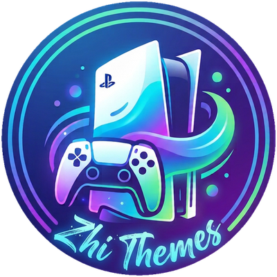

# ZhiThemes

**Custom themes for the real PS5 Home screen.** Made by **Zhi**.

This is not an app that looks like the PS5 menu. ZhiThemes changes the **real ShellUI**, the actual Home you use every day: your games row, your folders (yes, **folders**), the top bar, the game hub, Settings and Trophies. You keep using your PS5 like always, it just looks the way you want.

> **No system files are changed.** Everything happens in memory. Reboot without the payload and your PS5 is 100% stock again.

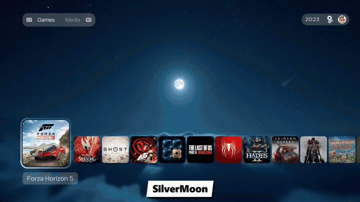

> **Alpha** (0.1.x). Made on firmware **9.60** and confirmed working on **13.60**. Other firmwares are untested. If you try one, please send a debug log (see [docs/LOGS.md](docs/LOGS.md)).

## What it can do

- **Game folders on the Home, built from scratch.** The PS5 never had folders on the Home, so ZhiThemes made them: group your games, give each folder a name, an icon and mosaic covers, and open it right there in the games row.
- **Vertical 2:3 covers** like a real game library, or square tiles, and a **Steam-style wide tile** for the focused game.
- **Your own covers, backgrounds and logos per game**, uploaded or searched on **SteamGridDB** straight from the editor.
- **Animated covers and backgrounds**: the focused game moves, and animated game backgrounds can be found on motionbgs.com from the editor.
- **Your own wallpaper**: a picture or an `.mp4` video playing behind the Home, and it keeps playing behind Settings and Trophies too. Plus 23 particle styles (snow, sakura, rain, starfield…).
- **Your own font** for the whole system, applied without a reboot.
- **A new top bar**: tabs with names or icons, extra tabs (Recently played, Favourites, Never played), and new buttons for **Power**, **Trophies** and your **controller battery**. Put the icons anywhere, even in a side bar.
- The **focus frame**, colours, the game name (or the game logo), your own clock, an animated avatar, animations and a lot more.
- **Settings and Trophies** themed as well, not only the Home.
- **Several themes on one PS5**, shared as one `.ztheme` file and installed from a **USB drive**.
- **Everything is edited live** from a web editor on your PC or phone. Press Apply and the Home reloads with the change in a few seconds.

  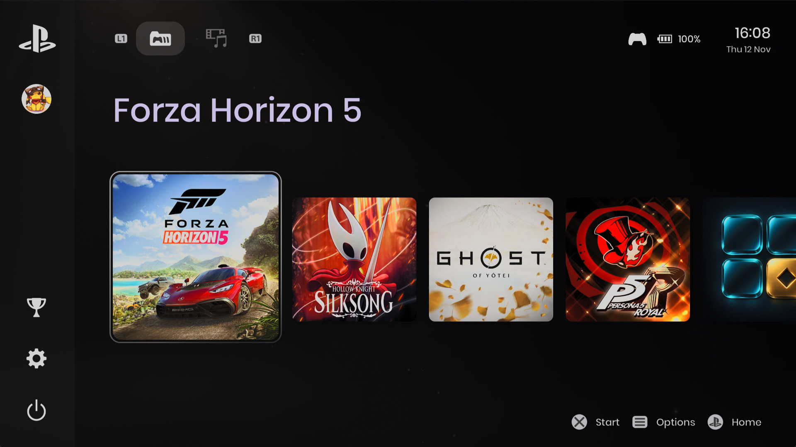
  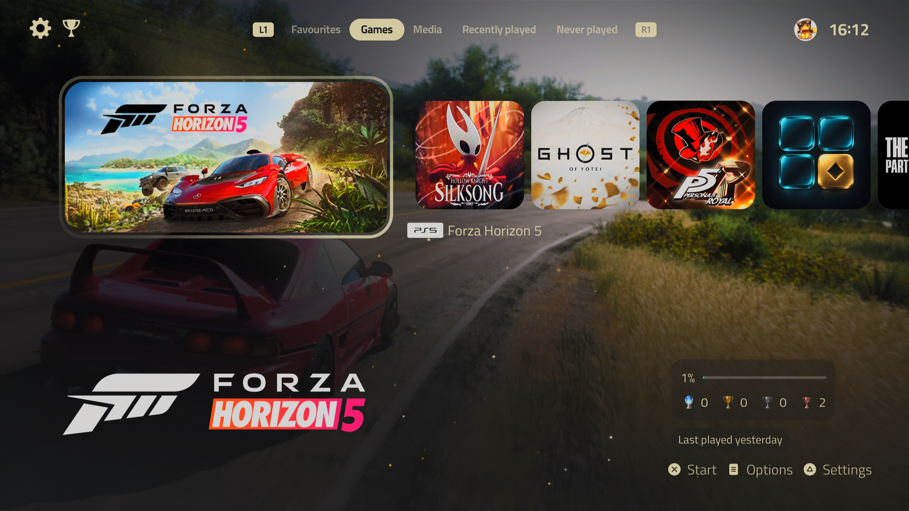

  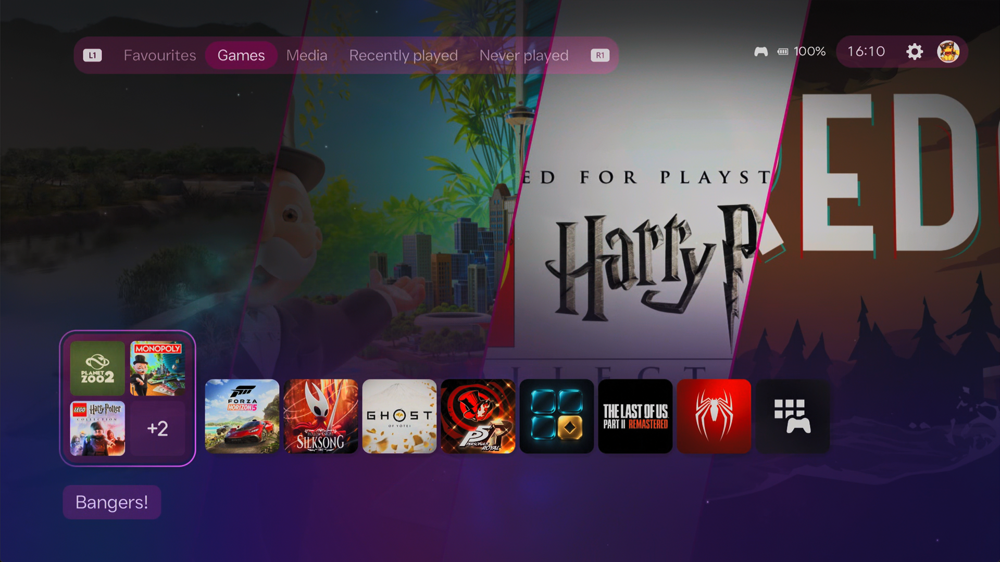
  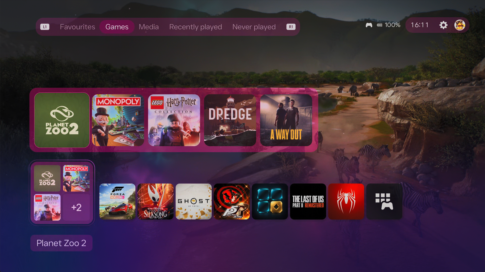

  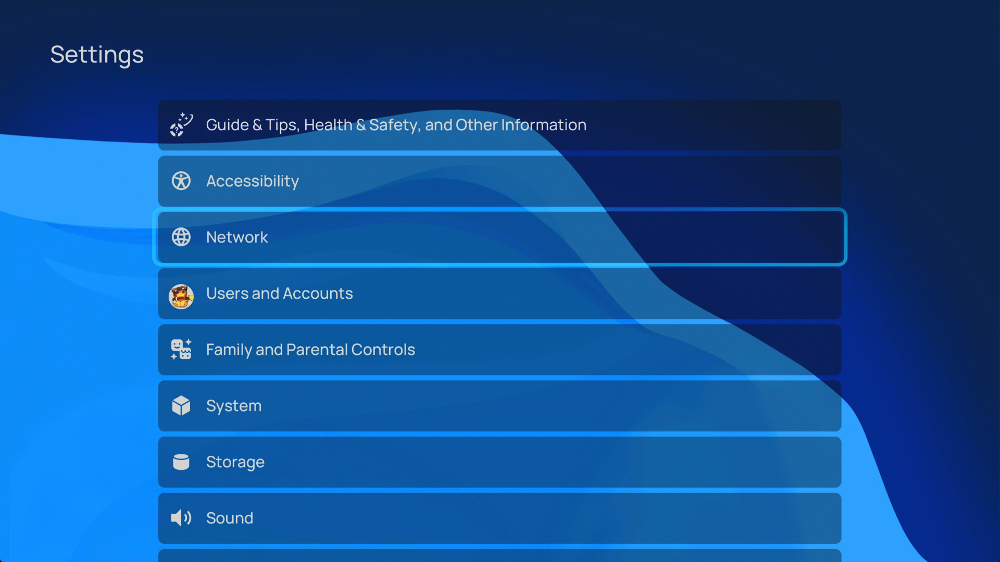
  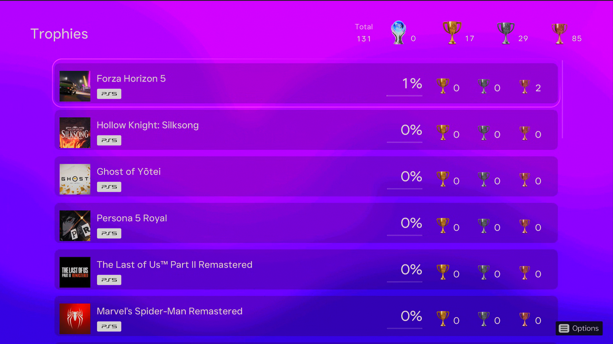

## How it works (the simple version)

`ZhiThemes.elf` is a normal payload. You send it to your ELF loader and it does three things:

1. **It stays running in the background** on the PS5 and opens a small web server on port **4444**. That's the editor.
2. **It goes inside ShellUI**, the system process that draws the Home. The PS5 Home and its screens (game hub, Game Library, Settings, Trophies) are built with React Native. Every time one of them loads, ZhiThemes runs its theme script **right before** the PS5 code, so it can change the layout, sizes, colours and pictures while the screen is being built. For the things that are not React Native (the focus frame, fonts, the system background, the video behind Settings) it uses small hooks in memory.
3. **It loads your theme** from `/data/ZhiThemes/` and puts it back every time ShellUI starts again (rest mode, a crash, a reload).

Nothing is patched on disk. The only folder ZhiThemes writes to is `/data/ZhiThemes/` (your themes, pictures and logs). A theme file can only hold values (numbers, true/false, text), never code.

If a theme ever breaks the Home, there is a **safe mode**: after two Home crashes within 3 minutes ZhiThemes turns the theme off by itself.

## What you need

- A PS5 with a working jailbreak that runs ELF payloads (kstuff and an ELF loader such as elfldr).
- **Not together with other HENs, for now:** ZhiThemes does not run while etaHEN, OnionHEN or AniketosHEN (or Yoncore, kylin-core, wmdw-jwm, CheatRunner) is loaded: they also load into the Home, and two of them crash it. ZhiThemes then does not load and shows a notification. Use kstuff + an ELF loader only.
- A PC or phone on the same network as the PS5, with a web browser.
- Optional: FTP access to the PS5, to copy files or read the logs without the editor.

## First steps

1. Download `ZhiThemes.elf` from [Releases](../../releases).
2. Send it to your PS5's ELF loader, like any other payload.
3. After a few seconds the PS5 says **"Welcome to ZhiThemes … Open <PS5-IP>:4444"**.
4. The first time, ZhiThemes starts **off** (*PS5 default*): your PS5 still looks stock. Nothing changes until you choose.
5. Open `http://<PS5-IP>:4444` in a browser on your PC or phone (same network).
6. Change anything and press **Apply** (or Ctrl+S). This creates your first theme, `Default`, and the Home reloads with it.

ZhiThemes lives in memory, so after a reboot you need to send the ELF again (or add it to your autoload). Your themes stay saved.

The full guide is in [docs/INSTALL.md](docs/INSTALL.md).

## Installing themes

A theme is a single `.ztheme` file. It has the settings and the files the theme uses (wallpaper or video, overlay, icons, fonts). Your folders and your covers are never touched: everyone keeps their own.

**From a USB drive**
1. Copy the `.ztheme` to a USB drive, in a folder called `ZhiThemes/` or `Themes/` (or just the root of the drive).
2. Plug it into the PS5.
3. On the Home, press **Options** on any game and open **🎨 ZhiThemes > Themes**.
4. Pick **Install from USB**. The theme is installed and turned on. The file stays on your drive, and if you change it later the menu shows **Update from USB**.

**From the Install folder**
Copy the `.ztheme` to `/data/ZhiThemes/Install/` (FTP or a file manager). It's installed the next time ZhiThemes starts, or right away from **🎨 ZhiThemes > Themes**. The file is deleted from `Install/` after it's installed.

**From the editor**
Use **Install** in the editor and pick the file from your PC or phone.

## Ready-made themes

Don't want to start from zero? There are 9 themes ready to use in [`default_themes/`](default_themes/). Use them as they are, or install one and change it in the editor to make it yours.

Get them all in one go with **`ZhiThemes-themes.zip`** on the [Releases](../../releases) page: extract it to the root of a USB drive (it makes `ZhiThemes/Themes/`), plug it in and open **Options > 🎨 ZhiThemes > Themes**. Or get them one by one from the folder (open the `.ztheme` and press **Download raw file**) and install them [like any other theme](#installing-themes).

**What does "Banned" mean?** Those themes are made for consoles that are always offline (banned or never connected). They hide the things you can't use without PSN: PS Store, PS Plus, the online parts of the Home, and the bottom part of the game hub. The others keep everything like the stock PS5.

| | |
|:---:|:---:|
| 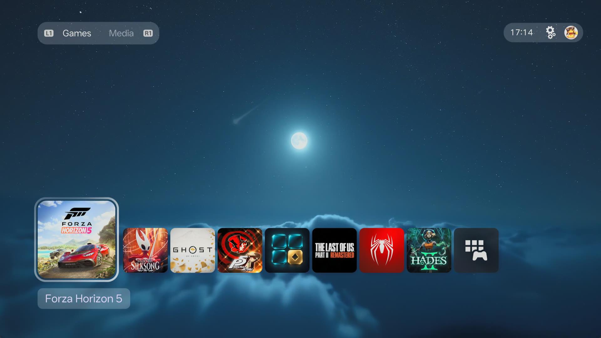 **SilverMoon** · Banned | 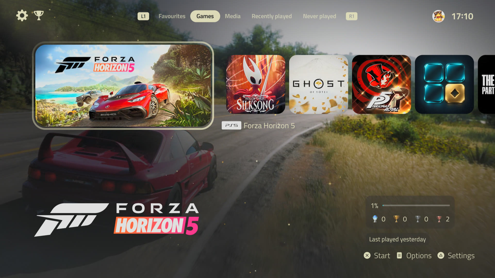 **KindaSelene** |
| 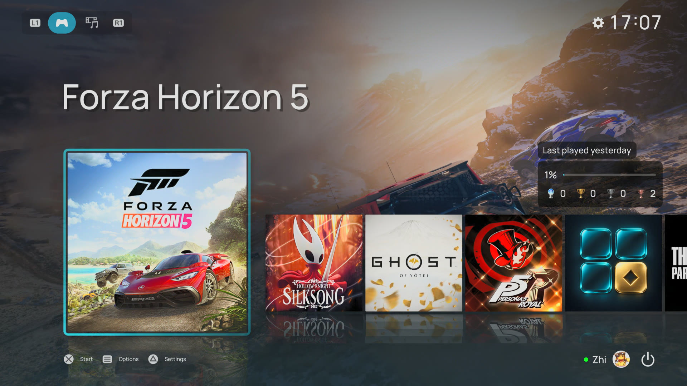 **CleanWaves** · Banned | 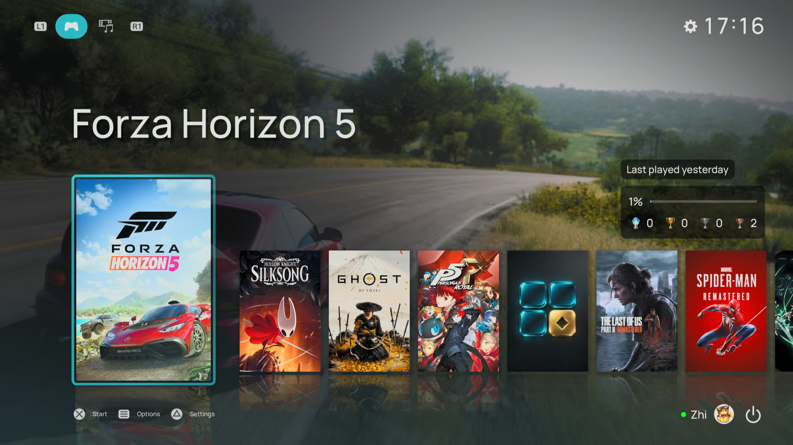 **CleanWaves Vertical** · Banned |
| 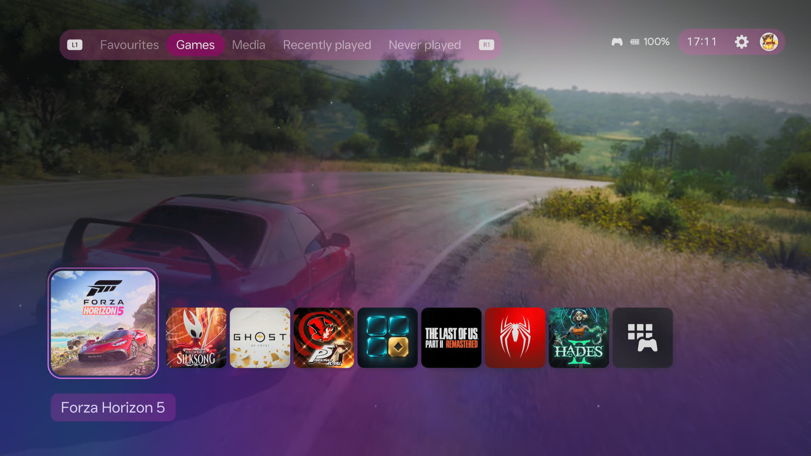 **LavaLampPurple** · Banned | 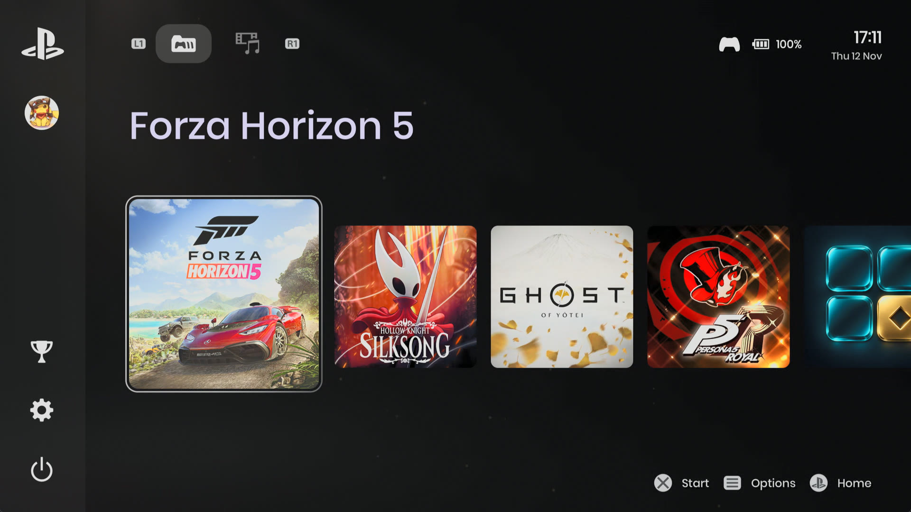 **ProjectClean** · Banned |
| 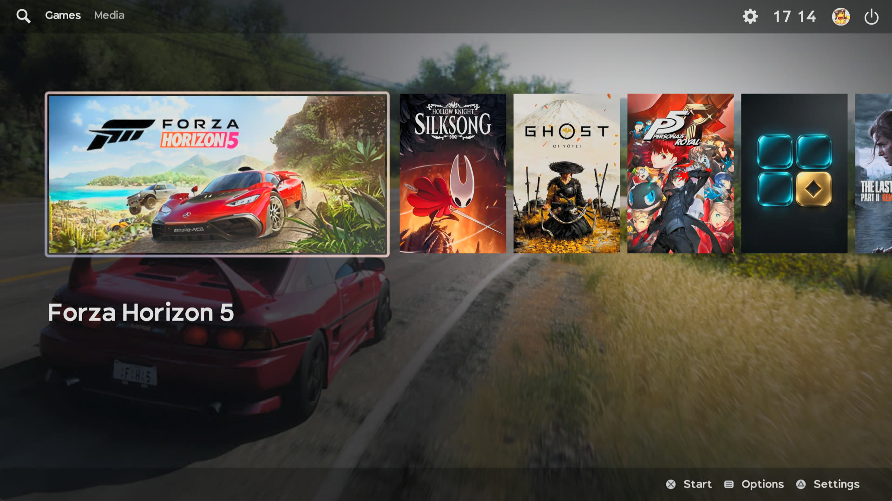 **SteamDik** | 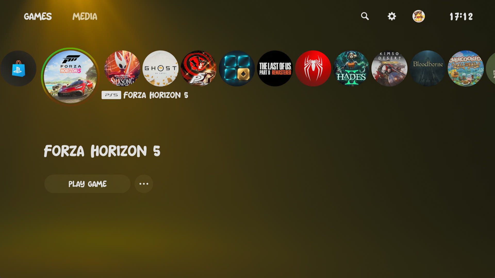 **RoundAround** |
| 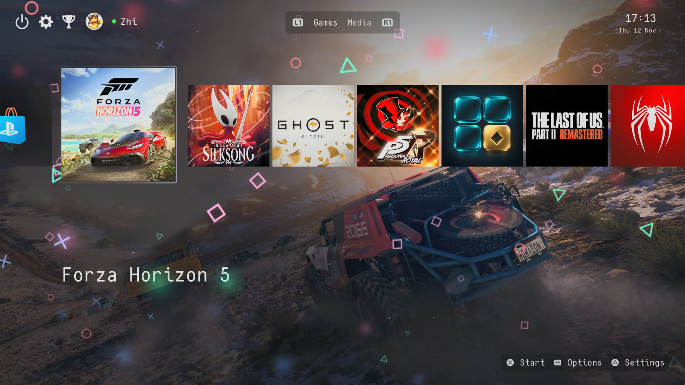 **sharpcorners** | |

The pictures, videos and fonts in these themes belong to their authors: see [CREDITS.md](CREDITS.md#example-themes).

## The 🎨 ZhiThemes menu

Press **Options** on any tile of the Home: the first item is **🎨 ZhiThemes**. You don't need the editor for the everyday stuff.

- **Themes**: switch theme, go back to **PS5 default** (ZhiThemes off), install from USB or the Install folder, back up all your themes to a USB drive.
- **Quick settings**: wallpaper, animated tiles, custom covers, the extra tabs and the debug panel, on or off.
- **Tools**: the editor's address, reload the theme, clear the picture cache, copy the logs to a USB drive.
- **About**: version and firmware, with QR codes for this page and for Ko-fi.

  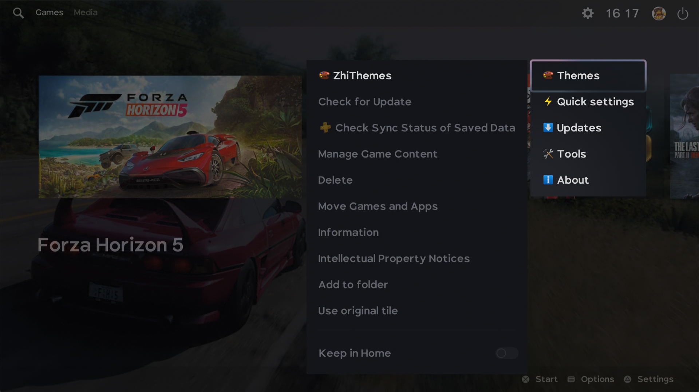 🎨 ZhiThemes > Themes" width="49%">
  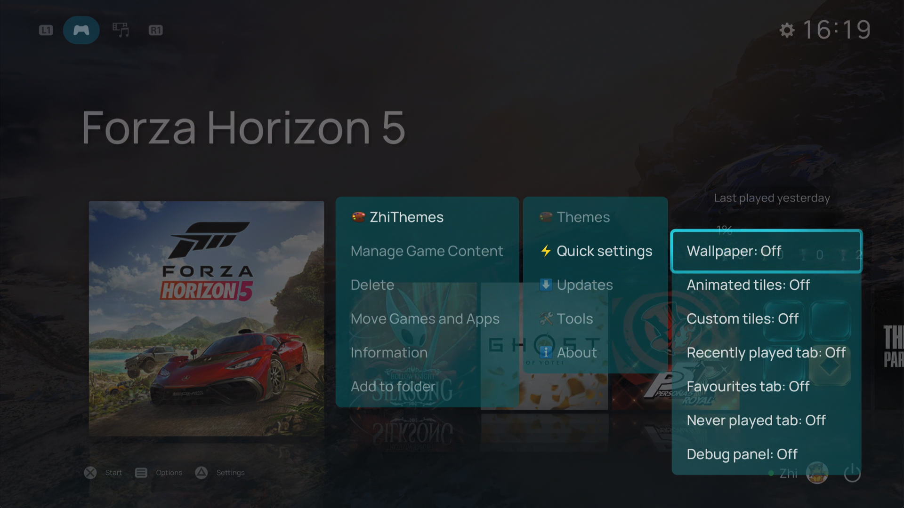 🎨 ZhiThemes > Quick settings" width="49%">

## Using the editor

Open `http://<PS5-IP>:4444` and you get the whole theme in one page.

- **Tabs on the left**, each named after the part of the screen it changes: Screen, Background, Games row, Top bar, Game page, Folders, Pictures, Text & fonts, Settings & Trophies, Extras.
- **Screen tab**: a picture of the Home. Drag things to move them (Ctrl + click to move several at once), click one to see all its options.
- **Apply** saves and reloads the Home on the PS5. Check the result on your TV and keep going.
- **Pictures tab**: click a game to give it a new cover, background or logo. Upload your own or search SteamGridDB.
- **Theme** (top bar): switch, rename, copy or delete your themes, or start a new one from the stock look.
- **Download** saves your theme as a `.ztheme` to share it. **Install** adds one from someone else.
- **Advanced** switch: shows the less used options. **Reset all** puts everything back to the stock PS5.
- **Logs tab**: if something goes wrong, turn on Debug mode and download the logs for a bug report.

More in [docs/THEMES.md](docs/THEMES.md).

  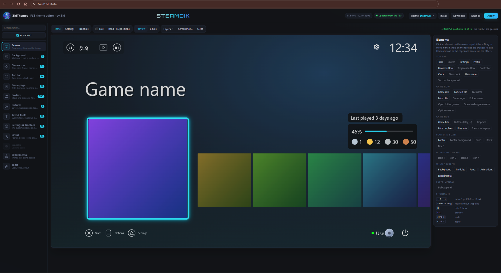
  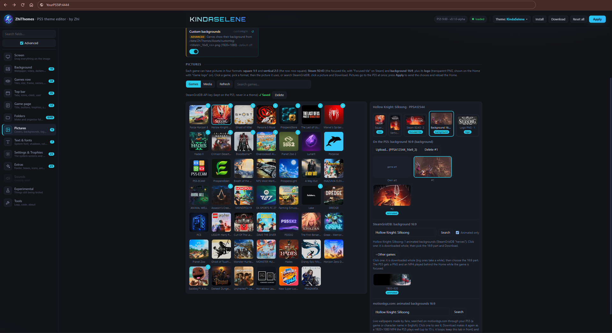

## Problems?

The editor's **Logs** tab has a **Debug mode** switch and the log files to download. Every log starts with the firmware and ZhiThemes version. The same files are on the PS5 in `/data/ZhiThemes/Logs/`, and **🎨 ZhiThemes > Tools** can copy them to a USB drive. See [docs/LOGS.md](docs/LOGS.md).

If a theme breaks the Home, put an empty file `ZhiThemes/no_theme` on a USB drive and plug it in: ZhiThemes stays off while the drive is in.

## Documentation

| | |
|---|---|
| [docs/INSTALL.md](docs/INSTALL.md) | Install, update, remove, files on the PS5 |
| [docs/THEMES.md](docs/THEMES.md) | Make, save and share themes (`.ztheme`) |
| [docs/LOGS.md](docs/LOGS.md) | Logs, debug mode, reporting problems, other firmwares |
| [docs/BUILDING.md](docs/BUILDING.md) | Build `ZhiThemes.elf` from source |
| [CHANGELOG.md](CHANGELOG.md) | Versions |

## Support

ZhiThemes is free. If you like it, you can buy me a coffee on [Ko-fi](https://ko-fi.com/zhi) ☕

## Credits and license

ZhiThemes was created by **Zhi** (original project: https://github.com/itsRealZhi/ZhiThemes). It is built on [OnionHEN](https://github.com/aydencharles/onionHEN) by aydencharles and contributors (injection into ShellUI, hooking, ELF loading). See [CREDITS.md](CREDITS.md).

ZhiThemes is free software under the **GNU GPL v3** ([LICENSE](LICENSE)), with one additional term (GPL-3.0 section 7(b)): **forks and redistributions must keep the author attribution "ZhiThemes by Zhi"** in the payload's welcome message, the editor, the logs and the documentation. See [NOTICE](NOTICE).

Not affiliated with or endorsed by Sony Interactive Entertainment. "PlayStation" and "PS5" are trademarks of their owners. Use at your own risk.
